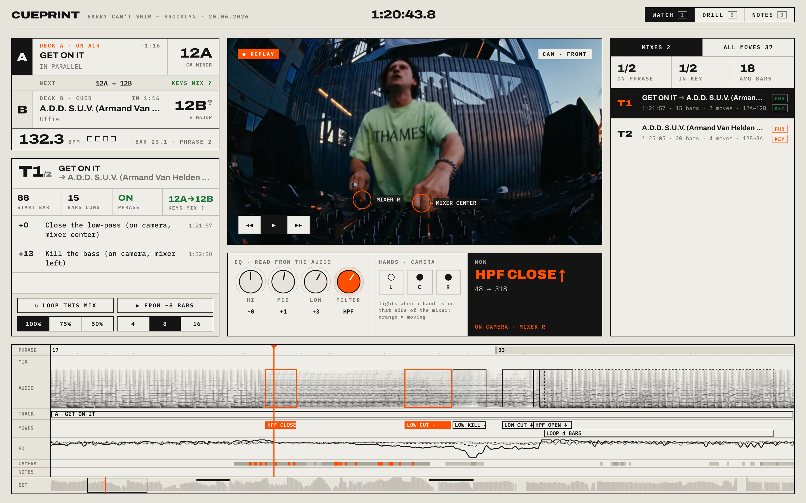
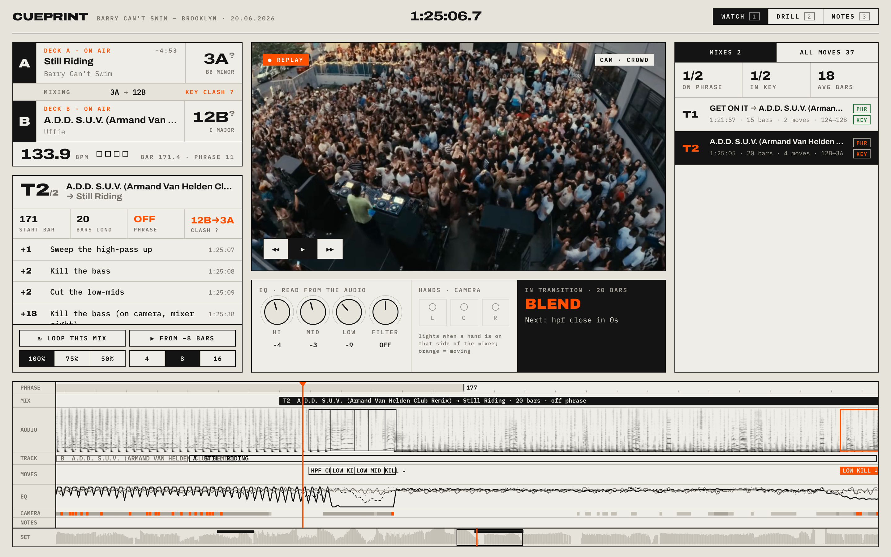

# Cueprint

Steal the mix, not the tracks.

Cueprint takes a video of a DJ set and breaks every transition down to the bar: when the mix started, which knobs moved, whether it landed on the phrase, and whether the keys fit. Then you loop that transition at 75% until you can do it yourself.

Everything runs on your machine. There are no accounts and nothing gets uploaded.



## What it does

- Paste a YouTube link or search for a set. If the upload has chapters or a timestamped tracklist, every track gets labeled.
- It finds the moves from the audio alone: bass kills, EQ cuts, high-pass and low-pass sweeps, loops and section changes.
- Moves get grouped into transitions, so each mix reads like a recipe: *bar +1 sweep the high-pass up, bar +2 kill the bass, bar +18 kill the bass again*.
- It tracks BPM, the beat grid and 16-bar phrases, and estimates each track's key in Camelot notation, flagging pairs that clash.
- Pose and hand tracking place each of the DJ's hands on a deck or on the left, center or right of the mixer, lined up against what the audio did.
- You can loop any transition with a 4, 8 or 16-bar lead-in, at 100%, 75% or 50% speed with the pitch unchanged.
- Drill mode blacks out the video and hides the answers, plays a real move from the set, and asks you what the DJ did.



## Run it

You need [Bun](https://bun.sh), plus `yt-dlp` and `ffmpeg` for YouTube import.

```bash
brew install yt-dlp ffmpeg   # or your platform's equivalent
git clone https://github.com/chrismathew3/cueprint
cd cueprint
bun install
bun run dev
```

Open http://127.0.0.1:5173 in Chrome, paste a set and pick a 10 to 20 minute range. Cercle uploads are a good first try because they come with chapter tracklists.

You can also drop in a local video (MP4, MOV or WebM).

## How it works

It's all TypeScript, and the heavy work runs off the main thread.

| Package | Job |
|---|---|
| `packages/core` | Shared types plus pure logic: transitions, Camelot keys |
| `packages/dsp` | The audio engine: FFT, beat tracking, EQ and filter curves, key detection, move detectors. Runs on a worker pool; a 10-minute set analyzes in about 0.2 s on 8 cores |
| `packages/media` | Streaming decode through WebCodecs ([Mediabunny](https://mediabunny.dev)) |
| `packages/vision` | MediaPipe hand and pose tracking on the GPU, in a worker |
| `packages/ui` | React 19 studio, WebGPU spectrogram, timeline lanes, drills |
| `apps/web` | Vite app, plus the local YouTube helper (`server/youtube.ts`) |
| `apps/mac` | Experimental Mac shell on [Vercel's Native SDK](https://github.com/vercel-labs/native) |

Analyzed sets stay in your browser (IndexedDB and the private file storage), so they reopen instantly.

## What to trust

A single stereo recording can't tell you which channel a knob was on, so EQ moves are read from the whole mix. The camera can say which side of the mixer a hand was on, but on edited multicam footage it can't prove a knob turned. The UI shows how often a hand is moving at a random moment, so you can judge what a camera match is worth.

Keys are estimates. Low-confidence keys show a `?`, so check them against your own library before trusting a clash flag.

Loops are hints. House tracks repeat on their own, so a detected loop is marked *not proven*.

## Extend it

- To detect a new technique, write a `Detector` (`packages/core`) and add it to `defaultDetectors` in `packages/dsp/src/detectors`.
- To show something new on the timeline, use `defineLane({ id, label, height, draw })`.
- To add a drill, map moves to answers in `packages/ui/src/components/Drill.tsx`.

```bash
bun test            # DSP, key and transition tests
bun run typecheck   # TypeScript 7 (tsgo)
```

## Notes

YouTube import is for studying sets on your own machine. Don't redistribute downloaded videos.

The screenshots show a frame from Barry Can't Swim's set in Brooklyn (June 2026).

Inspired by [@eminimnim's post](https://x.com/eminimnim/status/2107872135326621879) about breaking down a set by tracking the DJ's hands.

MIT licensed. The MediaPipe models and runtime are Apache-2.0 (see `THIRD_PARTY.md`).
